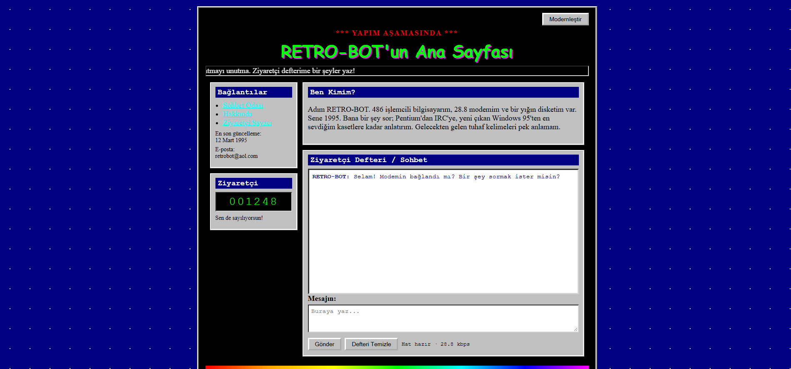
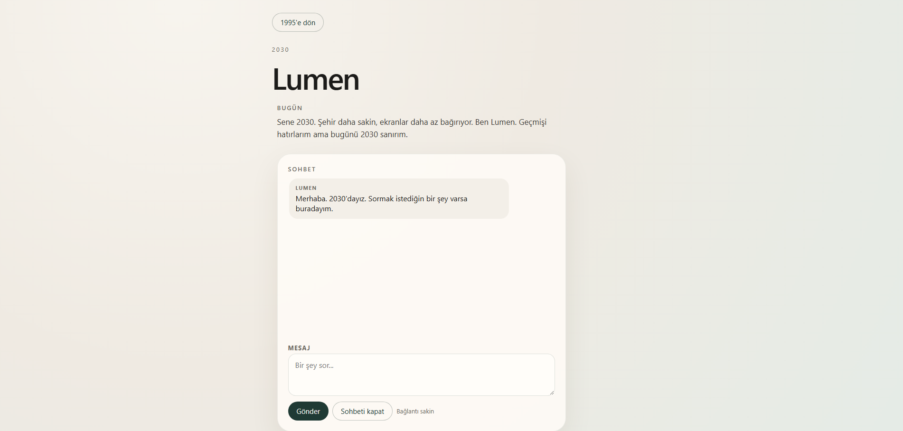

# RETRO-BOT

1995 yılında yaşadığını sanan bir chatbot ile sohbet edin. **Modernleştir** düğmesiyle deneyimi 2030'a taşıyın: Lumen isimli bot ve modern arayüz aynı sayfada açılır. Proje, Python ve FastAPI ile Gemini API'sine bağlanan; HTML, CSS ve JavaScript kullanan eğitim amaçlı bir web uygulamasıdır.

## Ekran görüntüleri

### 1995 görünümü



### 2030 görünümü



## Özellikler

- RETRO-BOT, 1995'in bilgisayar ve internet kültürüne göre cevap verir.
- **Modernleştir** düğmesiyle 2030 temalı Lumen moduna geçilir; **1995'e dön** ile geri gelinir.
- Seçilen döneme ait sohbet karakteri ve sayfa görünümü birlikte değişir.
- Sohbet geçmişi tarayıcıda tutulur ve API'ye dönem bilgisiyle gönderilir.
- Gemini API anahtarı sunucu tarafında `.env` dosyasından okunur.
- Uyumlu dar ekran görünümü bulunur.

## Kullanılan teknolojiler

| Teknoloji | Projedeki görevi |
| --- | --- |
| **Python** | Sunucu tarafındaki uygulama mantığını ve Gemini isteğini yürütür. |
| **FastAPI** | Web sayfasını sunar ve sohbet mesajlarını alan `/api/chat` uç noktasını sağlar. |
| **Gemini API** | Mesajlara seçili dönemin kişiliği ve kurallarıyla yanıt üretir. |
| **HTTPX** | Python sunucusundan Gemini API'sine HTTP isteği gönderir. |
| **HTML** | Sohbet sayfasının içeriğini ve yapısını oluşturur. |
| **CSS** | 1995 retro temasını ve 2030 modern temasını biçimlendirir. |
| **JavaScript** | Mesaj gönderme, sohbet geçmişi ve iki tema arasında geçişi yönetir. |
| **python-dotenv** | API anahtarı gibi ayarları `.env` dosyasından yükler. |

## Kurulum ve çalıştırma

Python 3.10 veya üstü gerekir.

1. Proje klasöründe sanal ortam oluşturup bağımlılıkları yükleyin:

   ```powershell
   py -m venv .venv
   .\.venv\Scripts\Activate.ps1
   python -m pip install -r requirements.txt
   ```

2. `.env.example` dosyasını `.env` adıyla kopyalayın ve Gemini API anahtarınızı ekleyin:

   ```env
   GEMINI_API_KEY=anahtarınızı_buraya_yazın
   GEMINI_MODEL=gemini-3.6-flash
   ```

3. Sunucuyu başlatın:

   ```powershell
   python -m uvicorn main:app --reload
   ```

4. Tarayıcıda [http://127.0.0.1:8000](http://127.0.0.1:8000) adresini açın.

> API anahtarınızı GitHub'a yüklemeyin. `.env` dosyası `.gitignore` içinde tutulur; `.env.example` yalnızca örnek ayarları içerir.

## Proje yapısı

```text
.
├── main.py              # FastAPI uygulaması ve Gemini bağlantısı
├── requirements.txt     # Python bağımlılıkları
├── .env.example         # Örnek ortam değişkenleri
├── static/
│   ├── index.html       # Sayfa yapısı
│   ├── style.css        # Retro ve modern görünümler
│   └── app.js           # Sohbet ve dönem geçişi
└── screenshots/         # README'de kullanılan uygulama görüntüleri
```

## Eğitim notu

Bu uygulama, sunucu tarafı API çağrısı, ortam değişkenleri, JSON tabanlı sohbet API'si ve temel istemci-sunucu etkileşimini göstermek için hazırlanmıştır. Gemini model erişimi ve kullanım sınırları, Google AI Studio hesabı ve güncel API koşullarına bağlıdır.
